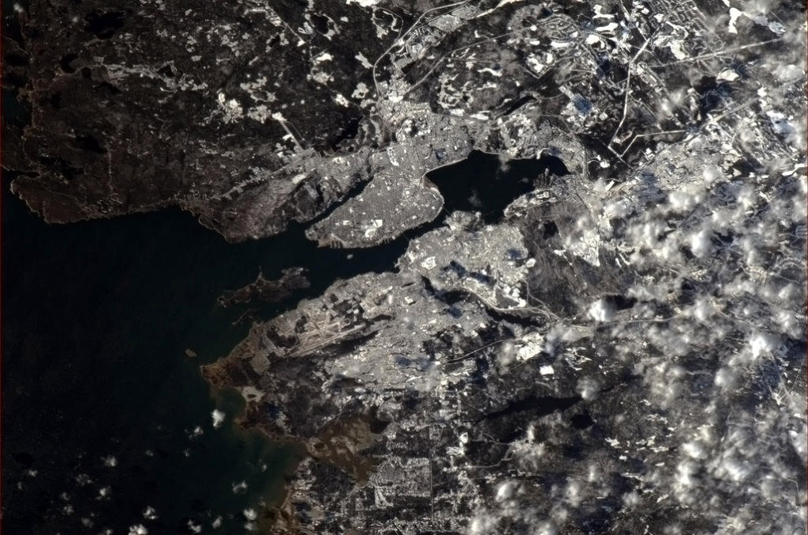
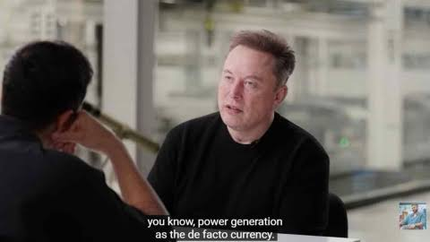

---
categories:
  - useful-tips/in-canada
date: 2026-09-24
description: 한국은 (앞이던 뒤에서이던)1등인게 참 많다.
lang: ko
last_updated: 2026-11-14
naver_date: 2026-09-24
naver_url: https://blog.naver.com/martin-lee/224421525523
tags:
  - 캐나다 생활
title: 캐나다가 1등인거
translation_key: 2026-09-24-where-canada-ranks-first
---

<figure data-image-caption="true">
  
  <figcaption><a href="https://www.ogq.me/backgrounds/1463859">© CoolPubilcDomains, 출처 OGQ</a></figcaption>
</figure>

한국은 (앞이던 뒤에서이던)1등인게 참 많다.

대학진학률, 출산율, 자살률, 스마트폰 보급율 등등에서 말이다.

이번에는 기업 측면에서 바라보자.

한국하면 떠오르는건 당연 **메모리 반도체, OLED** 이다.

한번씩 들어봤겠지만 **삼성과 SK하이닉스** 두 거대 기업이 한국을 먹여 살리고 있다.

그에 이어 **HD현대중공업, 삼성중공업, 한화오션** 과 같은 조선소가 뒷받쳐주고 있다.

다들 한번씩 들어본 대기업 이름이다.

그 외에 기업은 **고려아연** 이다.

산에 위치한 세계 최대 규모의 온산제련소를 운영중이고, 세계 최대 단일 비철금속 제련소이다.

단일 제련소 기준으로 아연 생산 세계 1위, 납 생산 세계 1위를 기록하고 있다.

연간 100만톤 이상의 비철금속을 생산하고 있다.

---

<figure data-image-caption="true">
  
  <figcaption><a href="https://www.ogq.me/backgrounds/1459671">© CoolPubilcDomains, 출처 OGQ</a></figcaption>
</figure>

이제 캐나다는 어떤게 1등인지 알아보자.

호수가 많다. 정부 자료에 따르면 0.1km^2 이상의 호수가 약 87만개가 있다고 한다.

세계 최대 운영 원자력 발전소 **Bruce Nuclear Generating Station** 가 있다. 온타리오 전력의 약 30%를 공급하고 있다. 캐나다의 핵심 주요 산업은 에너지, 광업류와 농업 식품이다.

TSX 증권시장을 보면 금, 구리, 우라늄, 리튬, 니켈, 은, 희토류 등 여러 자원들을 탐사하는 mining companies가 많이 상장되어 있다.

특히 **Potash 포타시⋅염화칼륨** 이다. 사스카츄완은 전 세계 포타시 매장량의 절반 가까이를 보유하고 있다.

**생산(세계 생산량 32.8%),**

**수출(세계 수출량 38.7%),**

**매장량(약 11억 톤)**

**포타시는 작물 수확량과 품질을 높이기 위해 필수적으로 사용하는 3대 요소(질소, 인산, 칼륨) 중 하나. 미국의 비료 중 90% 이상은 캐나다산 포타시를 수입하여 사용한다.**

주요 기업으로는 **Nutrien,** **The Mosaic Company** 이 있다.

그 다음으로는 **Uranium 우라늄** 이다.

카자흐스탄 다음으로 생산, 수출을 많이 하는 국가이다.

상업용 정련 시설은 Cameco Blind River Refinery 이다.

주요 기업으로는 Cameco, NexGen Energy 가 있다.

'단풍국'답게 메이플 시럽 생산량 1위이다.

그 외에도 Canola 카놀라유, Pluses, 귀리 Oats, Canary seed 수출도 1등이다.

캐나다는 국토가 넓은 국가이기도 하지만, 에너지와 광물, 식량 같은 세계의 기초 자원을 공급하는 데 강점을 가진 국가이다. 대 AI 시대의 가장 중요해지는건 돈 보다 에너지라고 일론머스크가 말했듯 캐나다가 언젠가는 빛을 바라는 날이 오지 않을까 기대를 해볼 수 있지 않을까싶다. 화성에 가기 전 까지는... 캐나다는 알버타, 사스카츄완이 중요하다.
