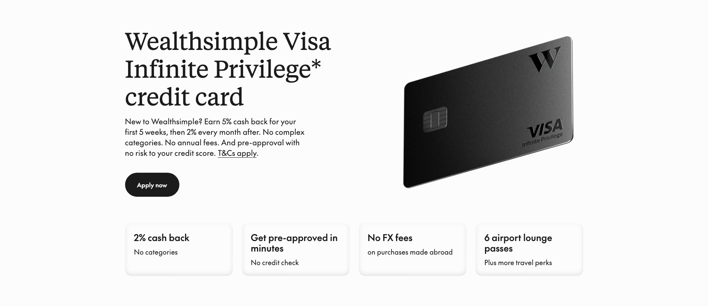
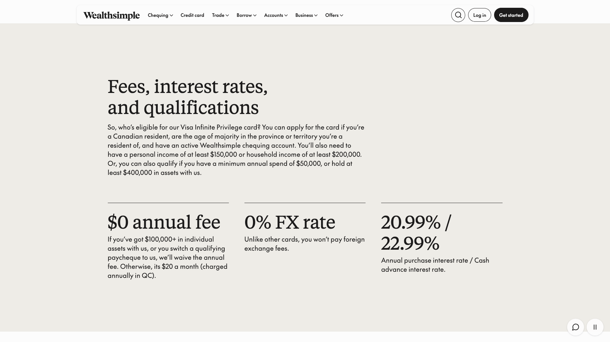

---
categories:
  - useful-tips/in-canada
date: 2026-11-10
description: 캐나다 신용카드 추천
lang: ko
last_updated: 2026-11-11
tags:
  - canada
  - credit-card
  - bank
title: 캐나다 신용카드 추천 (2)
translation_key: credit-card-recommend-2
---

## 들어가며

> **제휴 고지:** 이 글에는 작성자의 레퍼럴 링크가 포함되어 있습니다. 해당 링크로 카드가 승인되면 작성자가 포인트 보상을 받을 수 있습니다. 독자가 부담하는 카드 비용은 링크 사용 여부와 무관하며, 보상 가능성이 글의 평가 기준을 바꾸지 않습니다. 혜택과 수수료는 수시로 변경될 수 있으므로 신청 전 공식 약관을 확인하세요.

이전에 [캐나다 신용카드 추천](https://0xnefertt.github.io/ko/blog/category/useful-tips/in-canada/credit-card-recommend/) 글을 통해 American Express 아멕스 코발트 코발트를 추천했고, 현재도 잘 쓰고 있는 카드이다. 최근에는 새로운 카드를 발급받게 되어 또 다시 글을 작성하게 되었다.

이전 글에서도 언급하였지만 한번 더 언급을 하자면, RBC, CIBC, TD, Scotiabank, BMO 와 같이 대형 은행사에서 신용카드를 쓰는 것보다 더 좋은 조건의 신용카드를 발급해서 쓰는 것을 권장한다. 그 이유는 장기적인 관점과 편리성 때문이다. 캐나다에 온지 얼마 안된 워홀러 or 유학생 이라면, 각종 블로그/커뮤니티에서 추천하는 프로모션 프로그램을 통해 새로 은행 계좌를 오픈한다. 일부 조건만 달성하면 프로모션으로 소정의 금액 또는 상품을 받을 수 있고, 뉴커머라면 계좌유지비를 지원해주기도 한다는 장점이 있다. 반면 계좌를 장기간 보유할 것을 생각한다면 애초에 계좌유지비가 무료인 은행을 고르는게 좋지 않을까? 게다가 은행을 직접 가지 않고도 계좌를 오픈/해지를 할 수 있다면 얼마나 좋을까?

## 웰스심플 Wealthsimple Visa Infinite+

오늘 추천하고자 하는 신용카드는 웰스심플의 [**Wealthsimple** **Visa Infinite+**](http://wealthsimple.com/invite/JVU4P0) 이다. 이 카드의 발급 조건은 웰스심플 계좌를 하나 보유해야하며 다음 조건 중 한 가지 이상 충족 해야한다.

\- 개인 연소득 $80,000 이상  
\- 가구 연소득 $150,000 이상  
\- 보유 자산(저축·투자) $300,000 이상  
\- 연간 카드 지출액 $25,000 이상

정착한지 얼마 안된 뉴커머에게는 조금 달성하기 어려울 수 있겠지만, 직장 생활을 하고 정식적으로 룸 렌트 계약을 하고 렌트피를 월마다 지출하는 상황이라면 충분히 이 카드를 발급받는데는 어려움이 없을 것이다. (혹시나 렌트피를 은행에서 E-transfer로 이체를 했더라면, [첵시 Chexy](https://app.chexy.co/join/REF-EQLYVM) 라는 플랫폼을 이용하면 연간 지출액을 $25,000 넘기는건 쉽다.)

이 카드의 장점 중 하나는 **모든 결제 금액에 2%를 캐시백**으로 돌려받을 수 있다는 점이다. 이전에 소개했던 아멕스 코발트는 영역마다 포인트 지급해주는 비율이 달라 매번 체크하고 효율적으로 써야한다면 이는 모든 영역에서 자유롭게 쓰면 된다. (심지어 안받아주는 매장도 없음)

**하나 더 좋은 점은 환전 수수료도 없다**. 부가 혜택으로는 쇼핑/여행에 특화된 구매 보호, 휴대폰 파손/분실 보험, 여행자 보험 등 아직 제대로 사용해본 적은 없지만 여러모로 혜택이 있다. **연회비는 월 $20 이다.** 단, 웰스심플 계좌에 $100,000을 보유하고 있거나, 월 $4,000 이상 다이렉트 디파짓을 설정해둔다면 면제받을 수 있다. (= Wealthsimple Visa Infinite Privilege 등급)

마지막으로 큰 장점 중 하나는 **메탈 카드**이다.

---

## 혜택 극대화하기

[wealthsimple.com/invite/JVU4P0](http://wealthsimple.com/invite/JVU4P0)

추천 링크를 통해 Wealthsimple에 신규 가입하고 대상 신용카드를 발급받으면, 30일 동안 기본 2%에 추가 3%를 더한 총 5% 캐시백 혜택을 받을 수 있다. 

_해당 링크는 추천인 링크로, 가입 시 작성자에게도 혜택이 제공될 수 있습니다._

---

결론적으로, 필자는 캐나다에서 생활하면서 현 시점 가장 좋은 신용 카드는 **아맥스 코발트와 웰스심플 인피니트+** 라고 생각하며 전략을 굳이 만든다면

- 아맥스 코발트: 마트에서 장볼 때, 외식할 때,,,

- 웰스심플 인피니트+: 아맥스 코발트가 안되는 모든 곳

## 공식 자료

- [https://www.wealthsimple.com/en-ca/wealthsimple-visa-infinite-privilege-card](https://www.wealthsimple.com/en-ca/wealthsimple-visa-infinite-privilege-card)
